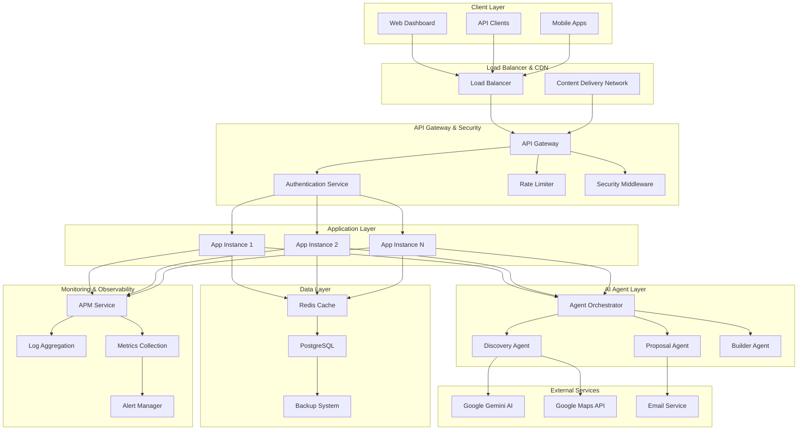
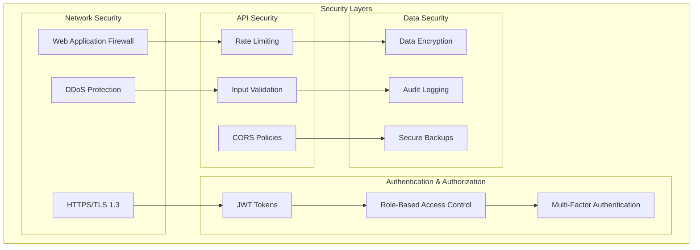

# Design Document

## Overview

This design document outlines the comprehensive architecture for upgrading the BizGrow AI project to production-ready status. The upgrade transforms the current development system into a scalable, secure, and maintainable platform capable of handling real-world enterprise workloads.

The design follows a layered architecture approach with clear separation of concerns, implementing industry-standard security practices, comprehensive monitoring, automated deployment pipelines, and advanced features necessary for production operations.

## Architecture

### High-Level System Architecture



### Security Architecture



## Components and Interfaces

### Authentication Service

**Purpose**: Centralized authentication and authorization management
**Technology**: Node.js with JWT, bcrypt, and express-rate-limit

**Key Components**:
- JWT Token Manager: Handles token generation, validation, and refresh
- Password Security: Implements bcrypt hashing with configurable rounds
- Role-Based Access Control: Manages user roles (Admin, Developer, User)
- Session Management: Handles token expiration and refresh logic

**Interfaces**:
```typescript
interface AuthenticationService {
  login(credentials: LoginCredentials): Promise<AuthResult>
  validateToken(token: string): Promise<TokenValidation>
  refreshToken(refreshToken: string): Promise<AuthResult>
  logout(token: string): Promise<void>
  checkPermissions(token: string, resource: string, action: string): Promise<boolean>
}

interface LoginCredentials {
  email: string
  password: string
  mfaCode?: string
}

interface AuthResult {
  accessToken: string
  refreshToken: string
  user: UserProfile
  expiresIn: number
}
```

### Rate Limiting Service

**Purpose**: API protection through intelligent request throttling
**Technology**: express-rate-limit with Redis store

**Key Components**:
- Tiered Rate Limiting: Different limits for different endpoint categories
- IP-based Tracking: Per-IP request counting and blocking
- Sliding Window Algorithm: Accurate rate limiting with burst handling
- Whitelist Management: Bypass mechanisms for trusted sources

**Configuration**:
```typescript
interface RateLimitConfig {
  auth: { windowMs: 900000, max: 5 }      // 5 attempts per 15 minutes
  api: { windowMs: 900000, max: 1000 }    // 1000 requests per 15 minutes
  agents: { windowMs: 60000, max: 10 }    // 10 operations per minute
  webhooks: { windowMs: 60000, max: 100 } // 100 webhooks per minute
}
```

### Monitoring and Observability Service

**Purpose**: Comprehensive system health and performance monitoring
**Technology**: Winston for logging, Prometheus for metrics, custom APM

**Key Components**:
- Application Performance Monitoring: Response times, throughput, error rates
- Structured Logging: JSON-formatted logs with correlation IDs
- Metrics Collection: Business and technical metrics aggregation
- Alert Management: Intelligent alerting with escalation policies

**Logging Structure**:
```typescript
interface LogEntry {
  timestamp: string
  level: 'error' | 'warn' | 'info' | 'debug'
  message: string
  correlationId: string
  userId?: string
  requestId?: string
  metadata: Record<string, any>
}
```

### AI Agent Orchestrator

**Purpose**: Intelligent coordination and management of AI agents
**Technology**: Node.js with custom orchestration logic

**Key Components**:
- Agent Lifecycle Management: Start, stop, restart, and health monitoring
- Task Queue Management: Priority-based task distribution
- Resource Allocation: Dynamic resource assignment based on load
- Performance Optimization: Learning-based agent performance tuning

**Interfaces**:
```typescript
interface AgentOrchestrator {
  registerAgent(agent: AIAgent): Promise<void>
  assignTask(task: AgentTask): Promise<TaskResult>
  getAgentStatus(agentId: string): Promise<AgentStatus>
  optimizePerformance(): Promise<OptimizationResult>
}

interface AgentTask {
  id: string
  type: 'discovery' | 'proposal' | 'builder'
  priority: number
  payload: any
  timeout: number
}
```

### Caching Layer

**Purpose**: High-performance data caching and session management
**Technology**: Redis with clustering support

**Key Components**:
- Multi-level Caching: Application, session, and query result caching
- Cache Invalidation: Smart invalidation strategies with TTL management
- Session Storage: Distributed session management for scalability
- Real-time Data: WebSocket connection state and real-time updates

**Cache Strategies**:
```typescript
interface CacheStrategy {
  businesses: { ttl: 3600, strategy: 'write-through' }
  proposals: { ttl: 1800, strategy: 'write-behind' }
  analytics: { ttl: 300, strategy: 'cache-aside' }
  sessions: { ttl: 86400, strategy: 'write-through' }
}
```

### Database Management System

**Purpose**: Robust data persistence with high availability
**Technology**: PostgreSQL with connection pooling and replication

**Key Components**:
- Connection Pooling: Optimized connection management with health checks
- Migration System: Version-controlled schema changes with rollback support
- Backup Automation: Scheduled backups with integrity verification
- Performance Optimization: Query optimization and index management

**Connection Pool Configuration**:
```typescript
interface DatabaseConfig {
  host: string
  port: number
  database: string
  user: string
  password: string
  pool: {
    min: 5
    max: 20
    acquireTimeoutMillis: 30000
    idleTimeoutMillis: 600000
  }
}
```

## Data Models

### Enhanced User Model

```typescript
interface User {
  id: string
  email: string
  passwordHash: string
  role: 'admin' | 'developer' | 'user'
  profile: UserProfile
  preferences: UserPreferences
  security: SecuritySettings
  createdAt: Date
  updatedAt: Date
  lastLoginAt?: Date
}

interface UserProfile {
  firstName: string
  lastName: string
  avatar?: string
  timezone: string
  language: string
}

interface SecuritySettings {
  mfaEnabled: boolean
  mfaSecret?: string
  loginAttempts: number
  lockedUntil?: Date
  passwordChangedAt: Date
}
```

### Enhanced Business Model

```typescript
interface Business {
  id: string
  name: string
  address: string
  coordinates?: { lat: number, lng: number }
  contact: ContactInfo
  digitalPresence: DigitalPresenceAnalysis
  opportunityScore: number
  status: BusinessStatus
  metadata: BusinessMetadata
  createdAt: Date
  updatedAt: Date
}

interface ContactInfo {
  phone?: string
  email?: string
  website?: string
  socialMedia?: SocialMediaLinks
}

interface DigitalPresenceAnalysis {
  hasWebsite: boolean
  websiteQuality: number
  socialMediaPresence: number
  onlineReviews: ReviewAnalysis
  seoScore: number
  mobileOptimization: number
}
```

### Audit and Compliance Model

```typescript
interface AuditLog {
  id: string
  userId?: string
  action: string
  resource: string
  resourceId?: string
  details: Record<string, any>
  ipAddress: string
  userAgent: string
  timestamp: Date
  severity: 'low' | 'medium' | 'high' | 'critical'
}

interface ComplianceReport {
  id: string
  type: 'SOC2' | 'GDPR' | 'HIPAA'
  period: { start: Date, end: Date }
  findings: ComplianceFinding[]
  status: 'compliant' | 'non-compliant' | 'pending'
  generatedAt: Date
}
```

### Performance Metrics Model

```typescript
interface PerformanceMetrics {
  id: string
  timestamp: Date
  service: string
  metrics: {
    responseTime: number
    throughput: number
    errorRate: number
    cpuUsage: number
    memoryUsage: number
    diskUsage: number
  }
  alerts?: Alert[]
}

interface BusinessMetrics {
  id: string
  date: Date
  metrics: {
    businessesDiscovered: number
    proposalsSent: number
    conversionRate: number
    revenue: number
    customerSatisfaction: number
  }
}
```

## Error Handling

### Centralized Error Management

**Error Classification System**:
```typescript
enum ErrorType {
  VALIDATION = 'VALIDATION_ERROR',
  AUTHENTICATION = 'AUTHENTICATION_ERROR',
  AUTHORIZATION = 'AUTHORIZATION_ERROR',
  RATE_LIMIT = 'RATE_LIMIT_ERROR',
  EXTERNAL_API = 'EXTERNAL_API_ERROR',
  DATABASE = 'DATABASE_ERROR',
  INTERNAL = 'INTERNAL_SERVER_ERROR'
}

interface ApplicationError {
  type: ErrorType
  code: string
  message: string
  details?: Record<string, any>
  correlationId: string
  timestamp: Date
  stack?: string
}
```

**Error Handling Middleware**:
```typescript
interface ErrorHandler {
  handleError(error: ApplicationError, req: Request, res: Response): void
  logError(error: ApplicationError): void
  notifyAdministrators(error: ApplicationError): void
  generateErrorReport(): Promise<ErrorReport>
}
```

**Recovery Strategies**:
- **Circuit Breaker Pattern**: Automatic service isolation during failures
- **Retry Logic**: Exponential backoff for transient failures
- **Graceful Degradation**: Fallback mechanisms for non-critical features
- **Health Checks**: Proactive service health monitoring

### Error Response Standards

```typescript
interface ErrorResponse {
  error: {
    type: string
    code: string
    message: string
    details?: Record<string, any>
    correlationId: string
    timestamp: string
  }
  meta?: {
    retryAfter?: number
    documentation?: string
    supportContact?: string
  }
}
```

## Testing Strategy

### Comprehensive Testing Approach

**Testing Pyramid Structure**:
1. **Unit Tests (70%)**: Fast, isolated component testing
2. **Integration Tests (20%)**: Service interaction validation
3. **End-to-End Tests (10%)**: Complete user workflow validation

**Property-Based Testing Framework**:
- **Library**: fast-check for JavaScript/TypeScript
- **Configuration**: Minimum 100 iterations per property test
- **Coverage**: All critical business logic and data transformations

**Testing Categories**:

**Unit Testing**:
- Authentication service functions
- Rate limiting algorithms
- Data validation logic
- AI agent individual operations
- Utility functions and helpers

**Integration Testing**:
- API endpoint functionality
- Database operations
- External service integrations
- WebSocket communication
- Cache layer interactions

**Property-Based Testing**:
- Data serialization/deserialization
- Business rule validation
- Security constraint verification
- Performance characteristic validation

**Performance Testing**:
- Load testing with gradual traffic increase
- Stress testing for breaking point identification
- Spike testing for traffic surge handling
- Volume testing for large dataset processing

**Security Testing**:
- Authentication bypass attempts
- Authorization escalation testing
- Input validation boundary testing
- SQL injection and XSS prevention
- Rate limiting effectiveness

**Test Configuration**:
```typescript
interface TestConfig {
  unit: {
    coverage: { threshold: 80 }
    timeout: 5000
  }
  integration: {
    timeout: 30000
    retries: 3
  }
  property: {
    iterations: 100
    timeout: 10000
    shrinking: true
  }
  e2e: {
    timeout: 60000
    retries: 2
    parallel: false
  }
}
```

## Correctness Properties

*A property is a characteristic or behavior that should hold true across all valid executions of a system—essentially, a formal statement about what the system should do. Properties serve as the bridge between human-readable specifications and machine-verifiable correctness guarantees.*

### Authentication and Authorization Properties

**Property 1: JWT Token Validation Consistency**
*For any* JWT token and protected endpoint, the Authentication_Service should consistently validate tokens and enforce permissions, rejecting invalid, expired, or insufficient-permission tokens with appropriate error responses
**Validates: Requirements 1.1, 1.3, 1.5**

**Property 2: Secure Credential Processing**
*For any* valid user credentials, the Authentication_Service should generate properly structured JWT tokens with correct role claims and implement secure password hashing using bcrypt with minimum 12 rounds
**Validates: Requirements 1.2, 1.6**

**Property 3: Role-Based Permission Hierarchy**
*For any* user role and resource access request, the System should enforce hierarchical permissions where Admin > Developer > User, ensuring users can only access resources appropriate to their role level
**Validates: Requirements 1.4**

### Security and Rate Limiting Properties

**Property 4: Comprehensive Rate Limiting**
*For any* API endpoint category and request pattern, the Rate_Limiter should enforce category-specific limits (auth: 5/15min, API: 1000/15min, agents: 10/min) and return 429 responses with retry-after headers when limits are exceeded
**Validates: Requirements 2.1, 2.7**

**Property 5: Security Response Standards**
*For any* HTTP response, the Security_Middleware should include required security headers (HSTS, CSP, X-Frame-Options) and enforce HTTPS redirects for all production communications
**Validates: Requirements 2.2, 2.4**

**Property 6: Input Validation and Sanitization**
*For any* potentially malicious input data, the System should sanitize and validate all inputs, preventing injection attacks and maintaining data integrity
**Validates: Requirements 2.3**

**Property 7: Authentication Failure Rate Limiting**
*For any* IP address with multiple authentication failures, the Rate_Limiter should temporarily block the IP after the configured threshold is exceeded
**Validates: Requirements 1.7**

### Performance and Caching Properties

**Property 8: Intelligent Caching Behavior**
*For any* frequently accessed data, the Cache_Layer should cache data with configurable TTL values and implement proper invalidation strategies to maintain data consistency
**Validates: Requirements 3.1, 3.6**

**Property 9: Database Performance Optimization**
*For any* database query execution, the System should utilize proper indexing and connection pooling to ensure 95% of queries execute within 100ms
**Validates: Requirements 3.3, 3.7**

**Property 10: Response Optimization**
*For any* API response larger than 1KB, the System should implement compression, and for static assets, should include appropriate cache headers
**Validates: Requirements 3.4, 3.5**

**Property 11: Connection Pool Management**
*For any* database connection pool state, the Database_Pool should maintain optimized connections with automatic scaling and health checks
**Validates: Requirements 3.2**

### Monitoring and Observability Properties

**Property 12: Comprehensive Monitoring Coverage**
*For any* system operation, the Monitoring_Service should track performance metrics (response times, error rates, throughput) and log all activities with structured formatting
**Validates: Requirements 4.1, 4.5**

**Property 13: Error Tracking and Context**
*For any* system error occurrence, the Error_Tracker should capture detailed error context, stack traces, and correlate events for debugging
**Validates: Requirements 4.2**

**Property 14: Automated Alerting**
*For any* critical threshold breach, the Monitoring_Service should send automated alerts via multiple channels and maintain 30 days of metrics history
**Validates: Requirements 4.4, 4.7**

**Property 15: Business Metrics Tracking**
*For any* business event, the Analytics_Engine should accurately track conversion rates, revenue, and other business metrics
**Validates: Requirements 4.6**

### Database Management Properties

**Property 16: Comprehensive Backup System**
*For any* backup operation, the Backup_System should create automated daily backups with 30-day retention, verify integrity through restore testing, and support point-in-time recovery
**Validates: Requirements 6.1, 6.4, 6.7**

**Property 17: Safe Database Migrations**
*For any* database migration, the System should execute changes safely with rollback capability and maintain data integrity
**Validates: Requirements 6.2**

**Property 18: Database Health and Recovery**
*For any* database connection or data corruption issue, the System should implement health checks, automatic recovery, and immediate administrator alerts
**Validates: Requirements 6.3, 6.5**

**Property 19: Database Performance Indexing**
*For any* database table and query pattern, the System should implement appropriate indexing strategies for optimal query performance
**Validates: Requirements 6.6**

### AI Agent Orchestration Properties

**Property 20: Agent Retry and Recovery**
*For any* failed AI agent operation, the System should implement retry logic with exponential backoff and graceful degradation for error recovery
**Validates: Requirements 8.1, 8.4**

**Property 21: Agent Coordination and Conflict Prevention**
*For any* concurrent agent processing scenario, the System should coordinate agent activities to prevent conflicts and ensure data consistency
**Validates: Requirements 8.2**

**Property 22: Agent Performance Optimization**
*For any* agent operation, the System should track performance metrics, optimize processing based on historical data, and support configurable priorities
**Validates: Requirements 8.3, 8.5**

**Property 23: Agent Health and Capacity Management**
*For any* agent health status or capacity limit, the System should monitor agent health, implement automatic restart capabilities, and queue requests when capacity is exceeded
**Validates: Requirements 8.6, 8.7**

### Notification and Communication Properties

**Property 24: Comprehensive Notification Delivery**
*For any* critical business event or system alert, the System should send real-time WebSocket notifications and multi-channel alerts (email, in-app) with delivery tracking and retry logic
**Validates: Requirements 9.1, 9.2, 9.4**

**Property 25: Notification Customization and Rate Limiting**
*For any* user notification preference, the System should respect customization settings, use consistent templates, and implement rate limiting to prevent spam
**Validates: Requirements 9.3, 9.5, 9.6**

**Property 26: Offline Notification Queuing**
*For any* offline user, the System should queue notifications and deliver them when the user reconnects
**Validates: Requirements 9.7**

### Multi-Tenant Architecture Properties

**Property 27: Tenant Data Isolation**
*For any* tenant data access or processing operation, the System should maintain strict data separation and enforce tenant-specific access controls
**Validates: Requirements 10.1, 10.2, 10.4**

**Property 28: Tenant Customization and Configuration**
*For any* tenant-specific setting, the System should support customization, branding, feature flags, and monitoring while maintaining isolation
**Validates: Requirements 10.3, 10.5, 10.6**

**Property 29: Tenant Quota Enforcement**
*For any* tenant resource usage, the System should enforce usage quotas and restrictions when limits are exceeded
**Validates: Requirements 10.7**

### API Management Properties

**Property 30: API Versioning and Compatibility**
*For any* API version change, the System should maintain semantic versioning, backward compatibility, and previous versions during deprecation periods
**Validates: Requirements 11.1, 11.2**

**Property 31: API Documentation and Validation**
*For any* API endpoint, the System should generate interactive documentation from code annotations and validate requests against OpenAPI schemas
**Validates: Requirements 11.3, 11.4**

**Property 32: API Lifecycle Management**
*For any* API change or deprecation, the System should provide SDK generation, implement change notifications, and log deprecated API usage with warnings
**Validates: Requirements 11.5, 11.6, 11.7**

### Security Audit and Compliance Properties

**Property 33: Security Audit Trail**
*For any* security-relevant event, the System should log events with tamper-proof audit trails and require additional authentication for sensitive operations
**Validates: Requirements 12.1, 12.2**

**Property 34: Data Encryption and Protection**
*For any* data at rest or in transit, the System should implement industry-standard encryption and detect/alert on security vulnerabilities
**Validates: Requirements 12.3, 12.4**

**Property 35: Compliance and Incident Response**
*For any* compliance requirement or suspected security incident, the System should support reporting for standards (SOC2, GDPR) and execute incident response procedures
**Validates: Requirements 12.5, 12.7**

**Property 36: Security Scanning and Assessment**
*For any* security scanning operation, the System should implement regular vulnerability assessments and process results appropriately
**Validates: Requirements 12.6**

### Analytics and Reporting Properties

**Property 37: Comprehensive Analytics Tracking**
*For any* user behavior or system usage, the Analytics_Engine should track detailed patterns and generate reports with real-time and historical data
**Validates: Requirements 13.1, 13.2**

**Property 38: Predictive Analytics and Anomaly Detection**
*For any* business forecasting need or system anomaly, the Analytics_Engine should implement predictive analytics and automatically alert stakeholders
**Validates: Requirements 13.3, 13.4**

**Property 39: Analytics Data Export and Access Control**
*For any* analytics data request, the System should support multiple export formats and enforce role-based access controls
**Validates: Requirements 13.6, 13.7**

### Webhook System Properties

**Property 40: Webhook Delivery and Retry**
*For any* webhook event, the Webhook_System should deliver notifications reliably to registered endpoints and implement retry logic with exponential backoff for failures
**Validates: Requirements 14.1, 14.2**

**Property 41: Webhook Security and Management**
*For any* webhook configuration, the System should support signature verification, queue events for unreachable endpoints, and implement filtering/transformation
**Validates: Requirements 14.3, 14.4, 14.6**

**Property 42: Webhook Rate Limiting and Quotas**
*For any* webhook delivery pattern, the System should enforce rate limiting and quotas when limits are exceeded
**Validates: Requirements 14.7**

### Infrastructure Optimization Properties

**Property 43: Auto-Scaling and Resource Management**
*For any* traffic pattern or resource utilization level, the System should implement auto-scaling up and down based on demand and track costs with detailed reporting
**Validates: Requirements 15.1, 15.2, 15.3**

**Property 44: Cost Management and Optimization**
*For any* cost threshold breach, the System should alert administrators and suggest optimizations
**Validates: Requirements 15.4**

**Property 45: Service Health and Recovery**
*For any* service failure or maintenance requirement, the System should implement health checks, automatic recovery, and support zero-downtime updates
**Validates: Requirements 15.6, 15.7**

### Testing Coverage Properties

**Property 46: Test Coverage Standards**
*For any* business logic component, the System should maintain unit test coverage of at least 80%
**Validates: Requirements 7.1**
## Testing Strategy

### Dual Testing Approach

The production upgrade implements a comprehensive dual testing strategy combining unit tests and property-based tests to ensure both specific functionality and universal correctness guarantees.

**Unit Testing (70% of test suite)**:
- **Authentication flows**: Login, logout, token refresh, permission checks
- **API endpoint functionality**: Request/response validation, error handling
- **Database operations**: CRUD operations, connection management, migrations
- **AI agent individual functions**: Discovery algorithms, proposal generation, project building
- **Security middleware**: Rate limiting, input validation, CORS enforcement
- **Caching mechanisms**: Cache hit/miss scenarios, TTL expiration, invalidation
- **Notification systems**: Email delivery, WebSocket connections, template rendering

**Integration Testing (20% of test suite)**:
- **Service interactions**: Authentication service with API endpoints
- **Database integration**: Connection pooling, transaction management
- **External API integration**: Google Gemini AI, Google Maps API
- **WebSocket communication**: Real-time updates, connection management
- **Cache layer integration**: Redis connectivity, data consistency
- **Email service integration**: SMTP configuration, delivery confirmation

**Property-Based Testing (10% of test suite)**:
- **Library**: fast-check for TypeScript/JavaScript
- **Configuration**: Minimum 100 iterations per property test
- **Universal properties**: All 46 correctness properties from the design
- **Data generators**: Custom generators for business entities, user credentials, API requests
- **Shrinking**: Automatic test case minimization for failure analysis

**Property-Based Test Configuration**:
```typescript
interface PropertyTestConfig {
  iterations: 100
  timeout: 10000
  shrinking: true
  verbose: true
  seed: 'random'
  examples: []
}
```

**Test Tagging Strategy**:
Each property-based test must include a comment tag referencing its design document property:
```typescript
// Feature: production-upgrade, Property 1: JWT Token Validation Consistency
fc.assert(fc.property(
  tokenGenerator,
  endpointGenerator,
  (token, endpoint) => {
    // Property test implementation
  }
), propertyTestConfig)
```

**Performance Testing**:
- **Load testing**: Gradual traffic increase to identify capacity limits
- **Stress testing**: Beyond-capacity testing to find breaking points
- **Spike testing**: Sudden traffic surge handling
- **Volume testing**: Large dataset processing capabilities
- **Endurance testing**: Extended operation under normal load

**Security Testing**:
- **Authentication bypass attempts**: Invalid token scenarios
- **Authorization escalation**: Role permission boundary testing
- **Input validation**: Malicious input injection testing
- **Rate limiting effectiveness**: Abuse scenario testing
- **Data encryption verification**: At-rest and in-transit encryption

**Test Environment Strategy**:
- **Development**: Local testing with mocked external services
- **Staging**: Production-like environment with real integrations
- **Production**: Monitoring-based testing with canary deployments

**Continuous Testing Integration**:
- **Pre-commit hooks**: Unit tests and linting
- **Pull request validation**: Full test suite execution
- **Deployment pipeline**: Automated testing at each stage
- **Production monitoring**: Continuous health checks and performance validation

**Test Data Management**:
- **Synthetic data generation**: Realistic test data without PII
- **Test data isolation**: Separate data sets for different test types
- **Data cleanup**: Automated test data removal after execution
- **Seed data management**: Consistent baseline data for testing

**Coverage Requirements**:
- **Unit test coverage**: Minimum 80% for business logic
- **Integration test coverage**: All service interactions
- **Property test coverage**: All critical business rules
- **End-to-end coverage**: Complete user workflows

**Test Reporting and Analytics**:
- **Coverage reports**: Detailed code coverage analysis
- **Performance metrics**: Test execution time tracking
- **Failure analysis**: Automated failure categorization
- **Trend analysis**: Test reliability and performance trends

The testing strategy ensures comprehensive validation of the production upgrade while maintaining fast feedback loops and reliable quality gates throughout the development and deployment process.