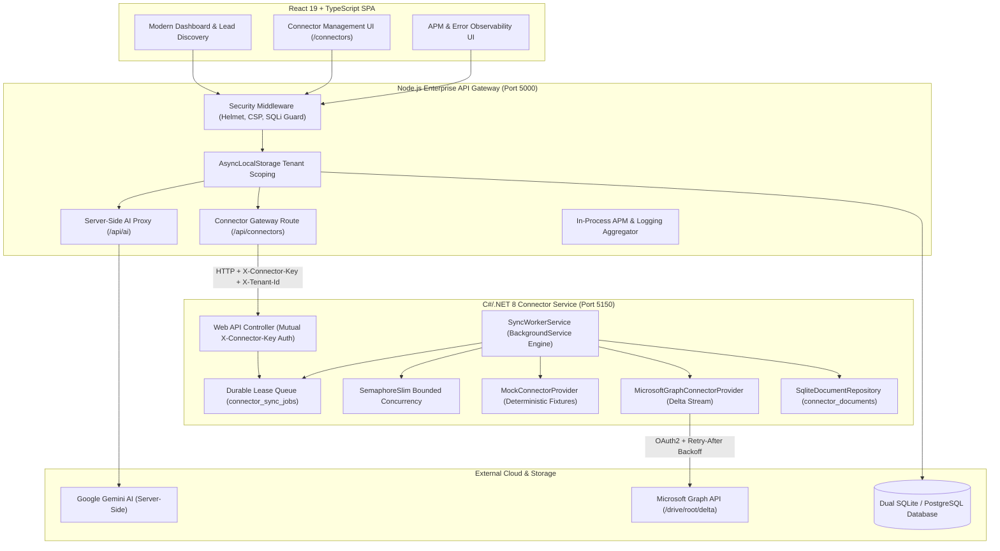
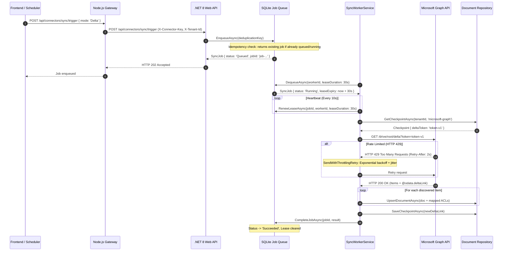

# BizGrow Enterprise Integration & Reliability Platform

[](https://dotnet.microsoft.com/)
[](https://nodejs.org/)
[](https://react.dev/)
[](https://www.typescriptlang.org/)
[](https://sqlite.org/)
[](https://xunit.net/)
[](https://jestjs.io/)

BizGrow is a multi-tenant enterprise integration, business automation, and reliability engineering platform. It combines an AI-powered SaaS application (React & Node.js) with a resilient C#/.NET 8 enterprise connector and document ingestion service capable of delta synchronization across Microsoft 365 (SharePoint & OneDrive) with adaptive rate limiting and lease-backed background workers.

---

## 🏛️ System Architecture



---

## 🔄 Distributed Delta Ingestion & Worker Lease Sequence



---

## 🎯 Technical Highlights & Architecture Decisions

### 1. Multi-Tenant Request Isolation (`AsyncLocalStorage`)
- **Vulnerability Remediated**: Replaced unsafe global singleton map with Node.js `AsyncLocalStorage`.
- **Anti-Spoofing Security Middleware**: Rejects client attempts to forge or override tenant contexts (`X-Tenant-Id` header mismatching JWT tenant claim returns HTTP 403 Forbidden).
- **Automated Verification**: Verified via `server/tests/tenant-isolation.test.js`.
- **Reference**: [ADR 001: Multi-Tenant Request Isolation Using AsyncLocalStorage](docs/adr/001-multi-tenant-isolation-asynclocalstorage.md)

### 2. C#/.NET 8 Connector Service with Microsoft Graph Delta Ingestion
- **Domain Modeling**: Strongly typed records and contracts (`IConnectorProvider`, `ExternalDocument`, `DocumentPermission`, `SyncCheckpoint`, `SyncRunResult`).
- **Microsoft Graph Integration**: Delta links (`@odata.deltaLink`), pagination (`@odata.nextLink`), and permission preservation (`grantedToV2` ACL roles).
- **Resilient Throttling Backoff**: Intercepts HTTP 429 responses, parsing `Retry-After` headers with exponential backoff and randomized jitter.
- **Reference**: [ADR 002: C#/.NET 8 Connector Service & Graph Delta](docs/adr/002-dotnet-connector-service-and-graph-delta.md)

### 3. Durable Lease-Backed Worker Engine
- **Atomic State Machine**: Database-backed job queue supporting `Queued -> Running -> Succeeded / Retrying / Failed / Cancelled`.
- **Worker Leases & Heartbeat**: Workers acquire a 30-second lease upon dequeue; a dedicated heartbeat loop continuously renews the lease during active syncs.
- **Crash Recovery**: Automatically reclaims abandoned jobs on worker startup when leases expire without a heartbeat.
- **Strict Idempotency**: Deduplication keys prevent redundant job enqueuing.
- **Bounded Concurrency**: Constrained using `SemaphoreSlim` to prevent downstream quota exhaustion.
- **Reference**: [ADR 003: Durable Lease-Backed Background Processing](docs/adr/003-durable-lease-backed-worker-queue.md)

### 4. Zero-Leak Security Remediation
- **Client Bundle Scrubbed**: Eliminated Gemini SDK API key exposure from Vite client builds (`vite.config.ts`), routing all AI operations through the secure Node.js backend proxy `/api/ai/*`. Bundle size reduced by ~300 kB.
- **Deep Security Protection**: Enforced Content-Security-Policy (CSP), SQL injection regex/AST scanners, XSS input sanitization, and streaming request size limits.
- **STRIDE Threat Model**: Comprehensive security audit available in [Threat Model](docs/threat-model.md).

---

## 🧪 Automated Testing & Verification

Both the .NET and Node.js codebases include automated test suites that run **100% offline without requiring paid cloud accounts**:

| Test Suite | Framework | Count | Coverage | Status |
| :--- | :--- | :--- | :--- | :--- |
| **.NET Connector Tests** | xUnit (.NET 8) | **9 / 9** | Delta queries, 429 throttling backoff, worker leases, crash recovery, document ACLs | ✅ Passed |
| **Tenant Isolation** | Jest + Supertest | **4 / 4** | AsyncLocalStorage scoping, concurrent queries, cross-tenant anti-spoofing | ✅ Passed |
| **Authentication Property** | fast-check + Jest | **8 / 8** | Dynamic bcrypt, JWT access & refresh token lifecycle, strength evaluation | ✅ Passed |
| **Security Property** | fast-check + Jest | **8 / 8** | CSP headers, XSS sanitization, SQL injection rejection, stream draining | ✅ Passed |
| **Migration Property** | fast-check + Jest | **7 / 7** | SQL parsing, forward/rollback validation, offline self-cleaning | ✅ Passed |
| **Database Property** | fast-check + Jest | **3 / 3** | Dual SQLite/PostgreSQL abstraction, pool monitoring, data integrity | ✅ Passed |

---

## 🚀 Quickstart Guide

### Prerequisites
- Node.js >= 18.x
- .NET 8 SDK (`dotnet --version` >= 8.0.x)

### 1. Run the Test Suites
```bash
# Run C#/.NET 8 xUnit test suite
dotnet test tests/BizGrow.Connectors.Tests/BizGrow.Connectors.Tests.csproj

# Run Node.js core property and security test suite
cd server
npm test -- tests/tenant-isolation.test.js tests/auth.property.test.js tests/security.property.test.js tests/database.property.test.js tests/migration.property.test.js
cd ..
```

### 2. Build the Applications
```bash
# Build .NET 8 Connector Service
dotnet build src/BizGrow.Connectors/BizGrow.Connectors.csproj

# Build React Frontend
npm run build
```

### 3. Launch Services Locally
```bash
# Terminal 1: Launch .NET 8 Connector Service (Port 5150)
dotnet run --project src/BizGrow.Connectors/BizGrow.Connectors.csproj --urls "http://127.0.0.1:5150"

# Terminal 2: Launch Node.js API Gateway (Port 5000)
npm --prefix server start

# Terminal 3: Launch Frontend Dev Server (Port 5173)
npm run dev
```

Navigate to `http://localhost:5173` and log in to explore:
- **Connectors & Ingestion**: Test connections, trigger delta syncs, inspect worker leases and document ACLs.
- **Lead Discovery & Proposals**: AI-driven business intelligence and digital maturity scoring.
- **APM & Performance Dashboard**: Real-time latencies, error tracking, and database metrics.

For a complete step-by-step verification walkthrough, see the [10-Step Demo Fixture Script](docs/demo-script.md).

---

## 📂 Repository Structure

```
bizgrow/
├── BizGrow.sln                           # .NET 8 Solution
├── src/
│   └── BizGrow.Connectors/               # C#/.NET 8 Enterprise Ingestion Service
│       ├── Controllers/                  # Connectors & Health Endpoints
│       ├── Domain/
│       │   ├── Interfaces/               # IConnectorProvider, ISyncJobQueue, IDocumentRepository
│       │   └── Models/                   # ExternalDocument, SyncCheckpoint, SyncJob, DocumentPermission
│       ├── Engine/                       # SyncWorkerService, SqliteSyncJobQueue, SqliteDocumentRepository
│       ├── Middleware/                   # ApiKeyAuthMiddleware (X-Connector-Key)
│       └── Providers/
│           ├── MicrosoftGraph/           # Microsoft Graph Delta Ingestion & 429 Backoff
│           └── Mock/                     # Deterministic Offline Fixtures & Delta Tokens
├── tests/
│   └── BizGrow.Connectors.Tests/         # xUnit Test Suite (9 passing tests)
│       ├── Engine/                       # SyncWorkerEngineTests (Lease, Idempotency, Crash Recovery)
│       └── Providers/                    # MicrosoftGraphConnectorTests & MockConnectorTests
├── server/                               # Node.js API Gateway & Multi-Tenant Backend
│   ├── agents/                           # Business Discovery, Proposal & Mediator Agents
│   ├── database/                         # SQLite/Postgres Init, Self-Healing Migrations
│   ├── middleware/                       # tenantIsolation (AsyncLocalStorage), auth, logging
│   ├── routes/                           # connectors.js, ai.js, businesses.js, proposals.js, etc.
│   ├── services/                         # tenantDataAccess, aiService, cacheService, apmService
│   └── tests/                            # Jest property & integration test harnesses (30 passing tests)
├── components/                           # React 19 Frontend Components
│   ├── ConnectorManagementPage.tsx       # Enterprise Connector Dashboard (Jobs, ACLs, Architecture)
│   ├── ModernDashboard.tsx               # Primary Business Automation Dashboard
│   ├── APMDashboard.tsx                  # Observability & Metrics
│   └── ...
├── docs/                                 # Architectural Documentation
│   ├── adr/                              # Architecture Decision Records (ADR 001, 002, 003)
│   ├── threat-model.md                   # STRIDE Threat Model & Defenses
│   └── demo-script.md                    # Reproducible 10-Step Verification Guide
└── App.tsx                               # Primary Route Definitions & Navigation
```

---

## 📜 License
MIT License. Created for MCA graduate portfolio demonstration in enterprise backend engineering, cloud integration, identity, and reliability.
